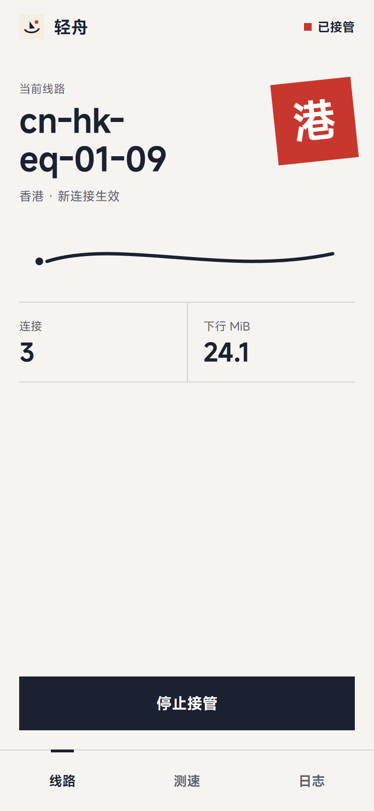
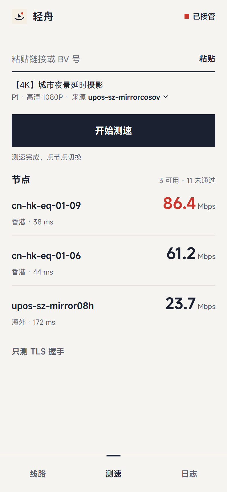
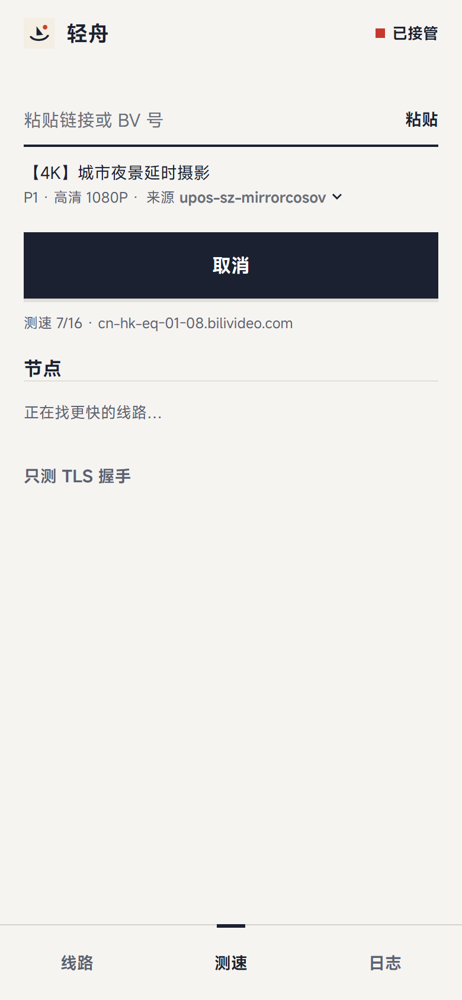
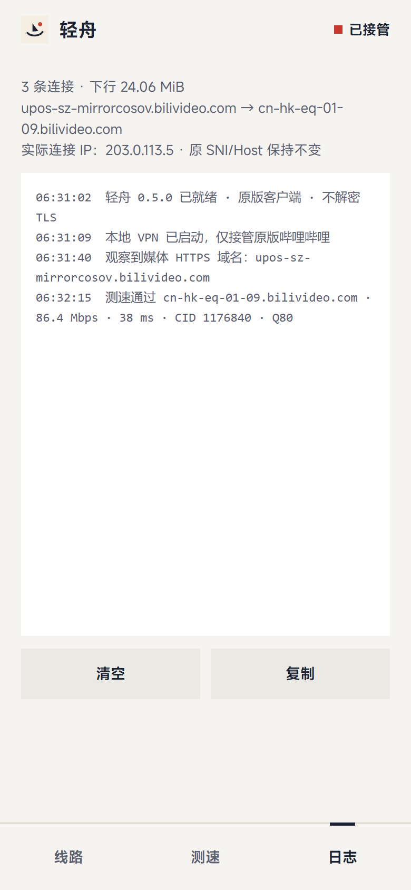

# bili-waypoint

海外看 B 站时，给视频换到更快的香港／海外 CDN 节点。两个工具：

- **驿程**：浏览器脚本，用于网页版视频页。
- **轻舟**：Android App，用于原版哔哩哔哩客户端，见[下文](#轻舟android)。

## 驿程（浏览器脚本）

**驿程**是 B 站视频页的香港／海外 CDN 节点优选脚本。从 [CCB 2.1.0](https://github.com/Kanda-Akihito-kun/ccb) 分出，保留原版的播放地址拦截和直播／番剧手动设置；只有节点列表仍取自上游。

- 每看几个视频，或播放卡顿时，测当前节点的延迟和吞吐；不达标就在香港／海外节点里找最快的 3 个。
- 点“改走 … 并刷新”才换源，脚本从不自己刷新页面。
- 标题旁的胶囊显示实时加载速度，点开是“驿程”浮层。


图文版说明见 [使用说明长图](dist/guide.png)。

### 安装

1. 装好 [Tampermonkey](https://www.tampermonkey.net/)。Chrome / Edge 还要在扩展详情里打开“允许用户脚本”。
2. 关闭旧版 CCB 和其他会改播放源的脚本，避免重复拦截。
3. 打开 [安装链接](https://raw.githubusercontent.com/Simohara/bili-waypoint/main/dist/yicheng.user.js)，点“安装”。以后按版本号自动更新。
4. 刷新 B 站视频页（海外访问跳到的 `/zh-Hans/video/` 也算），标题旁出现状态胶囊就装好了。

### 使用

**胶囊**
- **Mbps**：当前视频最近一段媒体下载的速度，不含首字节等待；没有新数据时显示最近一次测速结果。
- **ms**：HTTP 请求延迟，不是 ping。
- **路线图标**：测速时显示“n/15 巡站中”；有换源建议时末站变朱色，没找到可用节点时末站变空心。
- **—**：没有可靠样本。播放器已经缓冲完或暂停时，没有下载是正常的。

**浮层**：列出当前节点和它的问题（如“低于目标 35”），以及最多 3 个可换的节点，每个都有地区、延迟、速度和“当前几倍”。
- **改走 … 并刷新**：盖下“换”字驿印后刷新，并恢复播放进度。
- **保持当前**：放弃这次建议。
- **重新巡站**：立即测一遍，测速中变为“取消”。
- **设置**：检查间隔、延迟上限、目标速度，以及自动检查和卡顿检测的开关。

选好的节点对所有标签页生效（已打开的页面切回时改走新节点），有效 24 小时。在原版 CCB 面板里手动选节点或地区，会让之前的自动选择失效。

### 默认规则

| 项目 | 默认 |
| --- | --- |
| 自动检查 | 每看 3 个视频一次；视频要可见地播满 20 秒才计数；两次至少隔 10 分钟 |
| 卡顿检查 | 连续缓冲约 2.5 秒就测，不等计数；同一次卡顿只测一次，两次至少隔 90 秒 |
| 达标标准 | HTTP 延迟不超过 350 ms，速度不低于 35 Mbps。4K 码率更高时按码率的 1.3 倍提高；没有 4K 轨道时取最高轨道码率的 1.3 倍 |
| 检查当前节点 | 3 次 1 字节请求取延迟中位数，下 1 MiB 测速；结果可疑时再用 2 MiB 复测 |
| 找备选节点 | 每个节点先测 256 KiB，前 5 名一定用 2 MiB 复测并校验音频，取最快的 3 个达标节点 |
| 没找到 | 周期检查不弹浮层；30 分钟内不再周期检查，10 分钟内不做卡顿测速 |
| 建议有效期 | 2 分钟 |

测速只在前台进行。周期检查会等到播放位置之后至少缓冲 5 秒、最近 2 秒播放器没在下载时再测，免得只测到剩余带宽。切视频、切分 P 或隐藏标签页会取消测速。

### 节点来源

只用上游 [`data/cdn.json`](https://raw.githubusercontent.com/Kanda-Akihito-Kun/ccb/main/data/cdn.json) 里“香港”“海外”两组，不推荐大陆节点。运行时每小时最多更新一次；拉取失败就用缓存，再不行用脚本内置的快照（本仓库 `data/`）。“香港／海外”是上游的分组，不代表已核实服务器的物理位置。

## 轻舟（Android）

**轻舟**给原版哔哩哔哩 App 换节点：先测出哪个香港／海外节点最快，再用本地 VPN 把视频连接改走那个节点。

- 不改官方 APK，不需要 Root，不装证书。
- 不解密流量：原 TLS SNI、HTTP Host 和加密数据都保持不变，只改 TCP 连接的目标地址。
- 只接管哔哩哔哩一个 App，其他 App 的网络不受影响。

<p>




</p>

### 安装

1. 在 [Releases](https://github.com/Simohara/bili-waypoint/releases/tag/qingzhou-v0.5.0) 下载 `qingzhou-0.5.0.apk`（仓库里也有一份：[`dist/qingzhou/`](dist/qingzhou/)），在手机上打开安装，按提示允许“安装未知来源应用”。
2. 需要 Android 8.0 及以上（arm64 或 x86_64），手机上要装着原版哔哩哔哩。
3. 从“映途”或更早的 CCB 外置版升级时直接覆盖安装，包名和签名都没变；装好后重新点“启动接管”。

### 怎么用

1. **线路**页点“启动接管”，在系统弹窗里允许 VPN。同一时间手机上只能有一个 VPN。
2. 回到哔哩哔哩播放视频，让轻舟看到 App 实际用的媒体域名。
3. **测速**页粘贴 BV 号、视频链接或 b23.tv 短链（也可以从 B 站直接分享到轻舟），点“开始测速”。
4. 点结果里的一个节点，再点“应用”。之后新建的视频连接都改走这个节点。
5. 想回到原线路，点“停止接管”；断网或换网络时规则也会自动清除。

### 界面

底部三个选项卡，一屏只做一件事：

- **线路**：当前节点和地区印章，本次转接的连接数和下行流量，启动或停止接管。应用节点时，墨线从本机画到节点，再盖下印章。
- **测速**：逐个测香港／海外节点。每个节点下载 256 KiB 分段，和原线路做 SHA-256 对照，再按速度复测 2 MiB；结果按 Mbps 排序，最快的标朱红。“只测 TLS 握手”只比较建连耗时。
- **日志**：接管、测速、转接的每一步记录，可以清空或复制。

只覆盖 TCP 443 上的媒体连接，不保证 QUIC/UDP 和 IPv6。测速用的视频地址通过公开接口另外获取，清晰度可能低于 App 实际播放的；测速结果要在两分钟内、网络没变时应用。轻舟的源码不在这个仓库里。

## 开发

```bash
node scripts/update-nodes.cjs   # 可选：从上游刷新 data/ 的节点快照
node scripts/build.cjs          # 输出 dist/yicheng.user.js
node tests/run.cjs              # 主流程，结果写入 dist/test-results.json
node tests/ui.cjs               # 界面
```

`vendor/ccb.js` 是收进来的 CCB 2.1.0 原版，构建按锚点把 `src/` 拼进去，锚点对不上就停止构建。测试在本地模拟页面上用 Playwright 驱动系统 Chrome，没有在真实账号和播放器上验收。

| 路径 | 内容 |
| --- | --- |
| `src/auto-core.js` | 测速与调度规则 |
| `src/auto-runtime.js` | 页面识别、测速、换源批准、浮层 |
| `src/telemetry.js`、`src/worker-base.js` | 页面和 Worker 里的下载观测 |
| `src/stall-watcher.js` | 卡顿检测 |
| `src/widget.css` | 界面样式 |
| `vendor/ccb.js`、`data/` | CCB 原版脚本，节点快照 |
| `dist/` | 构建好的脚本、测试结果和截图；`dist/qingzhou/` 是轻舟的 APK 和界面图 |
